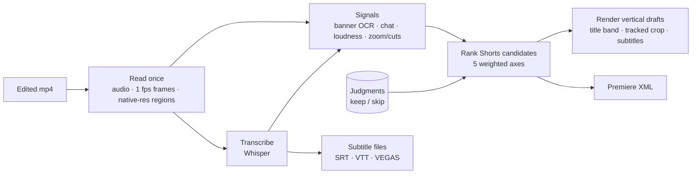

<div align="center">

# clipforge

**A Windows desktop app that turns an edited game stream into vertical Shorts drafts and subtitles**

It finds the moments where an item drop, the streamer's reaction and a chat burst line up, renders 9:16 drafts in rank order,<br>
and learns from every "keep / skip" you press.

[](https://github.com/jaeyeonling/clipforge/actions/workflows/ci.yml)


[한국어](README.md) · **English**


<sub>Make → progress → jumps to the drafts tab → keep (synthetic test clip, about 1.5× speed)</sub>

</div>

> The app UI and most documentation are in Korean — it was built for a Korean Diablo II: Resurrected streamer. This page summarises the project in English.

## What it does

- **Shorts drafts.** From a 10–15 minute edited episode it picks Shorts-worthy moments and renders vertical mp4 drafts: a handwritten title band, a crop that follows the inventory/tooltip, burned-in dialogue subtitles and the stream's own chat overlay. It also writes Premiere Pro XML (a vertical sequence per draft and a review sequence with markers).
- **Subtitles only.** Transcribes the whole video and exports SRT, VTT and a VEGAS Pro text file. About 1–2 minutes for a 10-minute 4K video on a GPU.
- **Learns from judgments.** Once six or more keep/skip judgments exist, it re-fits how much each ranking axis matters (item payoff, reaction, chat burst, completeness, first two seconds) and ranks the next drafts with it. A regularised fit keeps it close to the defaults while judgments are few.
- **Usable without explanation.** One button runs everything, a "next" line says what to do, unfamiliar terms have hover explanations, and the copy is plain conversational Korean.
- **Advanced (opt-in).** Edit-point candidates from multi-hour raw recordings, screen-region calibration, ranking metrics, and a live helper that proposes item-banner updates during a stream and pushes approved ones to OBS.

<table>
<tr>
<td width="50%"><br><sub>Drafts — play, then keep or skip</sub></td>
<td width="50%"><br><sub>First launch — three steps</sub></td>
</tr>
<tr>
<td width="50%"><br><sub>First run — engine components download in parallel</sub></td>
<td width="50%"><br><sub>Updates — applied in-app, never mid-job</sub></td>
</tr>
</table>

<sub>The video in the screenshots is a synthetic test clip.</sub>

## How it works



- **Engine** (`clipforge/`, Python 3.12): one FFmpeg decode pass extracts audio, frames and full-resolution crops of the OCR regions; RapidOCR reads the item banner and chat, faster-whisper the speech. Signals are plugins; per-game screen layout lives in `games/<game>.yaml`. FastAPI over HTTP + WebSocket, bound to 127.0.0.1 only.
- **UI** (`app/`, React + TypeScript + Vite): served by the engine, identical in a browser and in the desktop window.
- **Desktop** (`desktop/`, Electron): runs the engine as a child process; tray, notifications, a slim 88 MB installer that downloads the large components (Python runtime, CUDA libraries, FFmpeg, Whisper model) on first run, and in-app updates in three layers (app code, runtime components, shell) with SHA-256 checks and rollback.

Read more: [ARCHITECTURE.md](docs/ARCHITECTURE.md) · [ENGINE.md](docs/ENGINE.md) · [GAME_PROFILE.md](docs/GAME_PROFILE.md) (adding another game) — in Korean.

## Install

Download `clipforge-Setup-x.y.z.exe` from [Releases](https://github.com/jaeyeonling/clipforge/releases) and run it (no admin rights). The installer is not code-signed yet, so SmartScreen asks for "More info → Run anyway". On first launch it downloads about 3.3 GB of engine components. Windows 10/11 x64; an NVIDIA GPU is optional but makes transcription ~20× faster.

## Develop

```powershell
python -m venv .venv ; .\.venv\Scripts\activate ; pip install -r requirements.txt
cd app ; npm install ; npm run build ; cd ..
python -m clipforge.app                    # http://127.0.0.1:8765
cd desktop ; npm install ; npm start       # desktop window
powershell -ExecutionPolicy Bypass -File scripts\check.ps1   # everything CI runs
```

Quality gates: ruff (lint + format) and 56 pytest tests for the engine; Prettier, ESLint, strict TypeScript and 37 Vitest tests for the UI; Prettier, ESLint and 9 node tests for the desktop shell — all on a Windows CI runner.

## Status

A personal project, built and validated against one streamer's broadcasts. Verified end to end: edited episode → drafts and subtitles, first-run install from an empty runtime folder, the in-app update flow. Not yet verified in real use: Premiere XML import, edit points on a raw VOD, the live helper on a real broadcast.

## License

[MIT](LICENSE). Bundled third-party components (FFmpeg under GPL, the Whisper model, SIL OFL fonts, game data sources) are listed in [THIRD_PARTY_NOTICES.md](THIRD_PARTY_NOTICES.md). Diablo II: Resurrected is a trademark of Blizzard Entertainment; this project is not affiliated with Blizzard.
