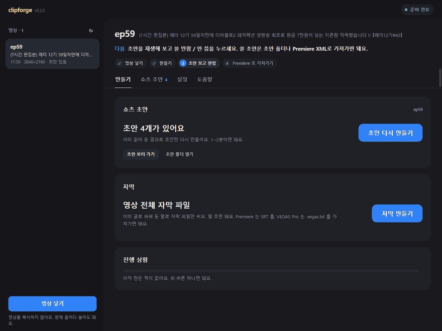
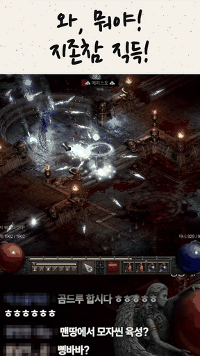
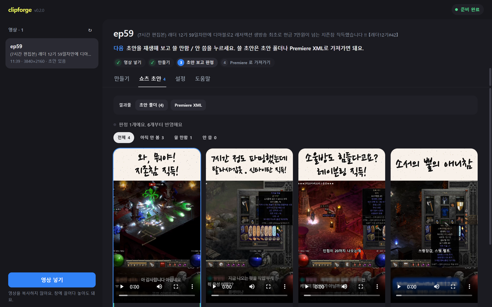
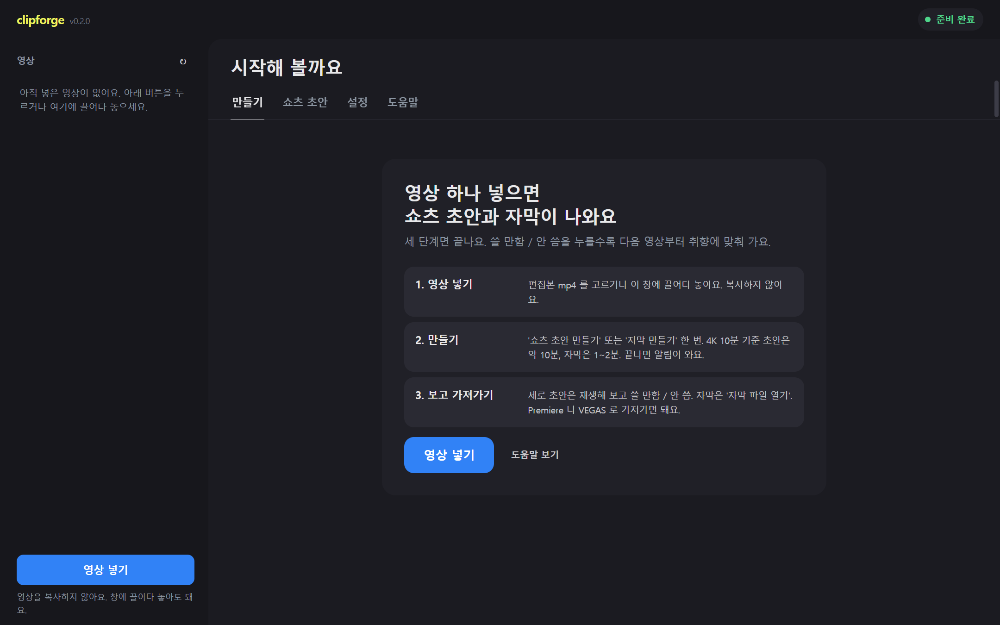
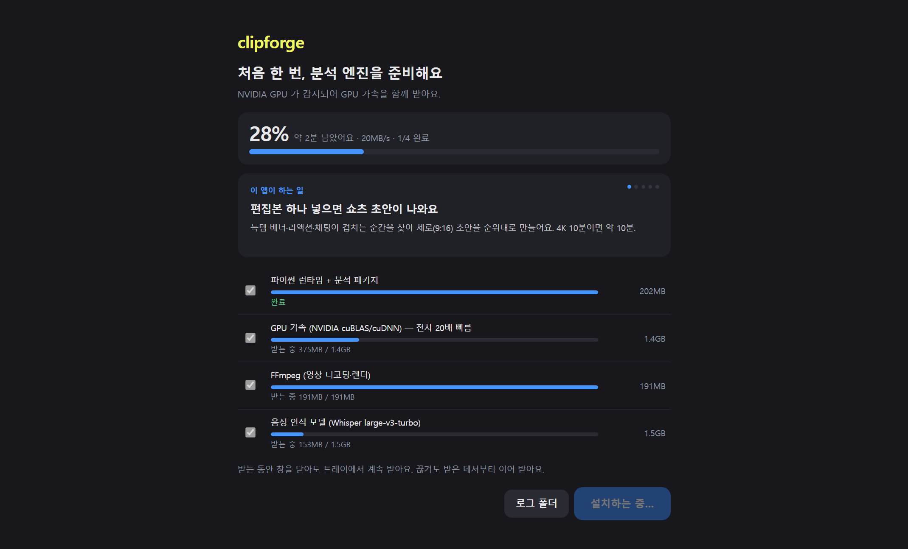
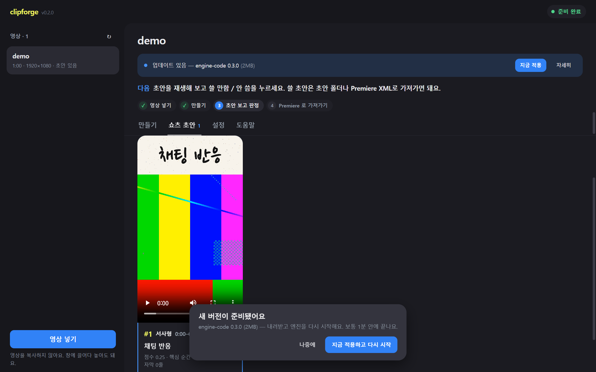
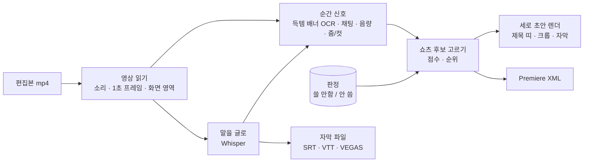

<div align="center">

# clipforge

**게임 방송 편집본을 넣으면 세로 쇼츠 초안과 자막이 나오는 Windows 데스크톱 앱**

득템 배너 · 리액션 · 채팅이 겹치는 순간을 찾아 9:16 초안을 순위대로 만들고,<br>
"쓸 만함 / 안 씀"을 누를수록 다음 회차부터 취향에 맞춰 갑니다.

[](https://github.com/jaeyeonling/clipforge/actions/workflows/ci.yml)


**한국어** · [English](README.en.md)

<table>
<tr>
<td></td>
<td></td>
</tr>
<tr>
<td align="center"><sub>만들기 → 진행률 → 쇼츠 초안 → 재생 → 쓸 만함</sub></td>
<td align="center"><sub>앱이 만든 초안 그대로</sub></td>
</tr>
</table>

<sub>스트리머의 허락을 받은 실제 방송 편집본이에요. 방송 채팅의 시청자 닉네임은 가렸고, 렌더를 기다리는 구간은 줄였어요.</sub>

</div>

## 무엇을 해 주나요

- **쇼츠 초안.** 10~15분 편집본에서 쇼츠로 쓸 만한 순간을 골라 세로 mp4 초안을 만들어요. 손글씨 제목 띠, 템 창을 따라가는 크롭, 대사 자막, 방송 채팅이 그대로 들어가요. Premiere 로 바로 여는 XML 도 같이 나와요.
- **자막만 만들기.** 영상 전체의 말을 글로 바꿔 SRT · VTT · VEGAS Pro 용 텍스트로 내보내요. 4K 10분이면 GPU 로 1~2분.
- **판정이 쌓일수록 정확해져요.** 쓸 만함 / 안 씀이 6개 이상 쌓이면 순위 기준(득템 · 리액션 · 채팅 반응 · 완결성 · 첫 2초)의 비중을 다시 맞춰, 다음 초안부터 비슷한 순간이 위로 올라와요. 쇼츠 초안 탭 위에 반영 상태가 한 줄로 보이고, 축별 비중은 고급 기능의 기록 탭에서 볼 수 있어요.
- **설명 없이 쓰는 화면.** 버튼 하나로 처음부터 끝까지 돌고, "다음" 줄이 지금 할 일을 알려줘요. 낯선 말에 마우스를 올리면 설명이 떠요.
- **고급 기능** (설정에서 켜기). 원본 녹화에서 편집 포인트 후보 뽑기, 화면 영역 보정, 판정 점수 기록, 방송 중 득템 배너 도우미(OBS 연동).

<table>
<tr>
<td width="50%"><br><sub>쇼츠 초안 — 재생해 보고 쓸 만함 / 안 씀</sub></td>
<td width="50%"><br><sub>처음 켰을 때 — 세 단계 안내</sub></td>
</tr>
<tr>
<td width="50%"><br><sub>첫 실행 — 엔진 구성요소를 동시에 받으며 소개를 보여줘요</sub></td>
<td width="50%"><br><sub>업데이트 — 재설치 없이 앱 안에서, 작업 중이면 끝난 뒤</sub></td>
</tr>
</table>

<sub>쇼츠 초안 · 업데이트 화면은 실제 방송 편집본(시청자 닉네임 가림)이에요.</sub>

## 설치

1. [Releases](https://github.com/jaeyeonling/clipforge/releases) 에서 `clipforge-Setup-x.y.z.exe` 를 받아 실행해요. 관리자 권한은 필요 없어요.
2. "Windows의 PC 보호" 창이 뜨면 **추가 정보 → 실행**. 아직 코드 서명이 없어서 떠요.
3. 처음 켜면 분석 엔진 구성요소(파이썬 런타임 · FFmpeg · 음성 인식 모델 · GPU 가속)를 받아요. 몇 GB 라 시간이 걸리고, 받을 크기와 남은 시간은 설치 화면에 나와요.

인터넷 없이 전달하려면 구성요소까지 담은 폴더를 만들 수 있어요. [desktop/README.md](desktop/README.md) 를 보세요.

| | 최소 | 권장 |
|---|---|---|
| OS | Windows 10/11 64비트 | |
| GPU | 없어도 돼요 (전사가 느려요) | NVIDIA (CUDA 12) — 전사 약 20배, 렌더 NVENC |
| 디스크 | 여유 10GB 이상 (구성요소 + 회차마다 캐시) | |

사용법은 [docs/USER_GUIDE.md](docs/USER_GUIDE.md) 한 장에 정리돼 있어요.

## 어떻게 동작하나요



- **엔진** (`clipforge/`, Python 3.12): FFmpeg 로 소리·프레임·화면 영역을 한 번에 뽑고, RapidOCR 로 득템 배너와 채팅을, faster-whisper 로 말을 읽어요. 신호는 플러그인이고 게임별 화면 배치는 `games/<게임>.yaml` 에 있어요.
- **화면** (`app/`, React + Vite): 엔진이 HTTP · WebSocket 으로 진행률과 결과를 보내요. 토스 디자인 결(한 화면 한 버튼, 큰 숫자, '~해요' 문구)을 따라요.
- **데스크톱** (`desktop/`, Electron): 엔진을 자식 프로세스로 띄우고 트레이 상주 · 알림 · 첫 실행 설치 · 앱 내 업데이트를 맡아요. 설치본은 작게 두고 큰 구성요소는 처음 켤 때 받아요.

지금은 디아블로2 레저렉션(한국어 클라이언트) 방송 화면에 맞춰져 있어요. 다른 게임은 화면 영역과 신호 묶음을 프로필로 더하면 돼요.

## 개발

```powershell
python -m venv .venv ; .\.venv\Scripts\activate ; pip install -r requirements.txt -c constraints.txt
cd app ; npm install ; npm run build ; cd ..
python -m clipforge.app                    # http://127.0.0.1:8765
cd desktop ; npm install ; npm start       # 데스크톱 창
powershell -ExecutionPolicy Bypass -File scripts\check.ps1   # CI 와 같은 검사 전부
```
FFmpeg 가 필요해요 (`winget install Gyan.FFmpeg`). 자세한 내용, 검사와 코드 규칙, CLI 실험 하네스, 신호 추가 방법은 [docs/DEVELOPMENT.md](docs/DEVELOPMENT.md) 에 있어요.

| 영역 | 포맷 · lint | 테스트 |
|---|---|---|
| 엔진 | ruff format · ruff check · mypy | pytest |
| 통합 | — | 합성 방송 → 세로 초안 · Premiere XML (실제 ffmpeg · OCR), 데스크톱 실행 · 설치본 첫 실행 화면 |
| 화면 | Prettier · ESLint · TypeScript strict | Vitest |
| 데스크톱 | Prettier · ESLint | node --test |

CI 는 Windows 러너에서 세 영역을 모두 돌려요.

```
clipforge/        분석 엔진 — 전처리 · 신호 · 후보 · 렌더 · 정렬 · 라이브 · API
  signals/        신호 플러그인 (item_banner, chat_burst, speech_keyword, …)
  api/            HTTP · WebSocket · stdio 메서드
  live/           방송 중 화면 감지 · OBS 연동
app/              React 화면
desktop/          Electron 껍데기 · 구성요소 설치/업데이트 · 설치본 설정
games/            게임 프로필 (화면 영역 · 신호 묶음 · 라벨 범주)
data/d2r/         아이템 사전 · 약어 사전
scripts/          포터블 런타임 · 릴리스 · USB 묶음 빌드
tests/            pytest
docs/             사용 안내 · 설계 문서
```

## 문서

| 문서 | 내용 |
|---|---|
| [USER_GUIDE.md](docs/USER_GUIDE.md) | 사용 안내 (한 장) |
| [ARCHITECTURE.md](docs/ARCHITECTURE.md) | 프로세스 구조 · 파이프라인 · API · 데이터 폴더 · 배포와 업데이트 |
| [ENGINE.md](docs/ENGINE.md) | 분석 코어: 신호 · 쇼츠 점수 · 판정 학습 · 렌더 · 평가 |
| [GAME_PROFILE.md](docs/GAME_PROFILE.md) | 다른 게임 추가하기 |
| [DEVELOPMENT.md](docs/DEVELOPMENT.md) | 개발 · 테스트 · CLI · 신호 추가 · 배포 명령 |
| [docs/](docs/README.md) | 문서 전체 지도: 설계 문서 · 시간순 설계 노트 · 조사 |

## 상태

개인 프로젝트이고, 한 스트리머의 방송을 기준으로 만들고 검증했어요.

- 검증됨: 편집본 → 쇼츠 초안 · 자막 전체 흐름, 첫 실행 설치(깨끗한 런타임 폴더), 앱 내 업데이트 화면.
- 실사용 확인 전: Premiere XML 가져오기, 원본 VOD 편집 포인트 실측, 라이브 탭 실방송.
- 설치본 서명: SignPath Foundation 에 신청하는 중이에요. 서명된 릴리스 전까지는 설치할 때 SmartScreen 경고가 떠요.

변경 내역은 [CHANGELOG.md](CHANGELOG.md) 에 있어요.

## 코드 서명 정책 (Code signing policy)

Free code signing provided by [SignPath.io](https://about.signpath.io), certificate by [SignPath Foundation](https://signpath.org).

- 서명하는 것은 이 저장소의 소스로 [릴리스 워크플로](.github/workflows/release.yml)가 GitHub 호스팅 러너에서 만든 Windows 설치본과 `clipforge.exe` 뿐이에요. 릴리스마다 승인자가 서명 요청을 직접 승인해요. 과정: [docs/CODE_SIGNING.md](docs/CODE_SIGNING.md)
- 작성 · 검토 · 서명 승인: [@jaeyeonling](https://github.com/jaeyeonling). 혼자 만들고 관리하는 프로젝트예요.
- 개인정보: [PRIVACY.md](PRIVACY.md). 영상 · 자막 · 판정은 이 PC 밖으로 나가지 않고, 업데이트 확인과 구성요소 내려받기를 위해 GitHub · PyPI 에만 접속해요.

## 라이선스

[MIT](LICENSE). 함께 배포되는 FFmpeg(GPL), Whisper 모델, 글꼴(SIL OFL), 게임 데이터 출처는 [THIRD_PARTY_NOTICES.md](THIRD_PARTY_NOTICES.md) 를 보세요.
Diablo II: Resurrected 는 Blizzard Entertainment 의 상표이고, 이 프로젝트는 Blizzard 와 관계가 없어요.
