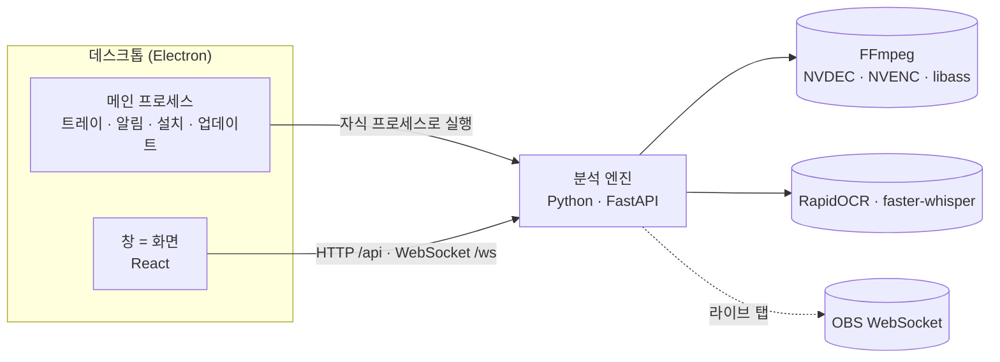

# 아키텍처

clipforge 가 지금 어떻게 짜여 있는지를 설명하는 문서예요. 분석 코어의 신호와 점수는 [ENGINE.md](ENGINE.md), 결정이 내려진 과정과 근거는 [notes/](notes) 에 있어요.

## 한눈에



세 덩어리는 **프로세스 경계**로 나뉘고 JSON 으로만 대화해요.

- **엔진** (`clipforge/`): 영상을 읽고, 신호를 찾고, 초안·자막·Premiere 파일을 만들어요. `127.0.0.1` 에만 열리는 HTTP · WebSocket 서버이고, 같은 메서드를 stdio JSON Lines 로도 낼 수 있어요.
- **화면** (`app/`): React 단일 페이지. 엔진이 빌드 결과를 그대로 서빙해서 브라우저로 열어도, 데스크톱 창 안에서 열어도 같은 코드가 돌아요.
- **데스크톱** (`desktop/`): 엔진을 띄우고 지켜보며, 창 · 트레이 · OS 알림 · 첫 실행 설치 · 앱 내 업데이트를 맡아요.

경계를 둔 이유: 엔진은 ML 생태계 때문에 Python 이 맞고, 배포와 GUI 는 웹 기술과 Electron 이 강해요. 경계가 있으니 화면을 바꿔도 엔진이 모르고, 엔진 부품을 나중에 다른 언어로 옮겨도 화면이 몰라요.

## 엔진

| 모듈 | 하는 일 |
|---|---|
| `project.py` | 앱 폴더(코드·프로필·폰트)와 데이터 폴더(영상·캐시·판정)를 나누는 설정 객체. FFmpeg 탐색, 환경 진단(`health`) |
| `jobs.py` | 작업(Job) 러너. 단계 실행, 진행률, 남은 시간, 취소, 작업 로그와 매니페스트 |
| `api/methods.py` | 전송과 무관한 엔진 메서드 (`Engine`). 회차 · 작업 · 판정 · 화면 영역 · 라이브 · 지표 |
| `api/server.py` · `api/stdio.py` | HTTP + WebSocket 서버, stdio JSON Lines 전송 |
| `preprocess.py` | 단일 패스로 오디오 · 1초 프레임 · 화면 영역 원본 크롭 · 장면 전환을 뽑아요 (NVDEC 우선) |
| `transcribe.py` · `subtitles.py` | faster-whisper 전사(GPU, 실패 시 CPU), 자막 큐 · SRT · VTT · ASS · VEGAS |
| `signals/` | 신호 플러그인. 레지스트리에 이름으로 등록 |
| `adapters.py` · `candidates.py` · `shorts.py` | 이벤트 → 곡선, 편집 포인트 후보, 쇼츠 후보와 점수 |
| `render.py` · `topband.py` · `textdraw.py` | 세로 초안 렌더(제목 띠 · 크롭 추적 · 자막 굽기), 한글 텍스트 렌더 |
| `export_xml.py` | Premiere(xmeml v5) 세로 시퀀스와 리뷰 시퀀스 |
| `align.py` | 오디오 랜드마크 지문으로 편집본·쇼츠를 원본에 정렬 → 정답 구간 |
| `evaluate.py` · `eval_shorts.py` · `weaklabel.py` | recall · coverage, hit@K · MRR, 제목으로 약한 정답 |
| `calibrate.py` · `profiles.py` | 화면 영역 점검 · 미리보기 · 저장, 게임 프로필 로더 (공통 설정 + 게임 덮어쓰기 + 사용자 값) |
| `preference.py` | 판정 학습: 쓸 만함 / 안 씀으로 쇼츠 점수 축의 가중치를 다시 맞춤 |
| `live/` | 방송 중 화면 캡처 → 아이템 라벨 감지 → 승인 → OBS 텍스트 소스 · 북마크 |
| `errors.py` · `schema.py` | 오류 분류, 저장 파일의 스키마 버전과 마이그레이션 |

### 파이프라인 단계

회차 하나에 대해 단계를 순서대로 돌려요. 각 단계는 앞 단계가 캐시에 남긴 파일만 읽어서, 이미 돈 단계는 다시 돌지 않아요.

| 단계 | 읽는 것 | 남기는 것 | 편집본 | 원본 |
|---|---|---|:-:|:-:|
| `prep` 영상 읽기 | 영상 | `cache/<id>/` meta · audio.wav · frames/ · rois/ · 장면 전환 | ● | ● |
| `transcribe` 말을 글로 | audio.wav | transcript.json (단어 시각 포함) | ● | ● |
| `subtitles` 자막 | transcript.json | `premiere/<id>/<id>.srt` · .vtt · .vegas.txt | 선택 | 선택 |
| `signals` 순간 신호 | frames · rois · audio · transcript | `<signal>.json` (곡선 또는 이벤트) | ● | ● |
| `candidates` 편집 포인트 | 신호 | candidates.json | | ● |
| `align` 정답 만들기 | 원본·편집본 오디오 | `labels/<id>.csv` (kept) | 선택 | ● |
| `shorts` 쇼츠 후보 | 신호 · 전사 · 판정 | shorts.json | ● | |
| `export` 세로 초안 | shorts.json · 영상 | `review/<id>/shorts/*.mp4` · .srt | ● | |
| `xml` Premiere | 후보 | `premiere/<id>_shorts.xml` · `_review.xml` | ● | 선택 |
| `weaklabel` 제목 정답 | 제목 · 배너 신호 | `labels/<id>.shorts.csv` | 선택 | |
| `eval` 점수 | 후보 · 정답 | 보고서 · 지표 | 선택 | ● |

회차 종류(편집본/원본)마다 돌릴 신호 묶음은 `games/common.yaml` 의 `pipelines` 에서 정해요. 원본은 길어서 OCR 이 무거운 채팅 신호와 편집본에만 뜻이 있는 컷·줌 신호를 빼요.

### 작업(Job)

- 작업은 엔진 안의 스레드 하나에서 단계별로 돌고, 진행률 · 단계 · 메시지 · 남은 시간을 WebSocket 으로 흘려보내요.
- 남은 시간은 이전 작업의 매니페스트에서 "영상 1분당 단계별 초"를 배워 추정해요. 처음엔 기본값을 써요.
- 끝나면 `reports/jobs/<job>_<회차>.manifest.json` (파라미터 · 단계별 소요 · 오류 · 엔진과 스키마 버전)과 `.jsonl` 로그를 남겨요. 엔진을 다시 켜도 작업 이력이 보여요.
- 끝났지만 사람이 봐야 할 것(예: 화면 영역 적중률이 낮음)은 `warnings` 로 따로 실어 화면에 노란 카드로 보여요.
- 취소하면 FFmpeg · OCR 하위 프로세스를 끊고 캐시는 그대로 둬요.

### API

HTTP 경로는 `/api` 아래에 있고, 실시간 이벤트는 `/ws` 하나로 와요. 전체 스키마는 엔진을 띄우고 `/docs` 에서 볼 수 있어요.

| 묶음 | 경로 |
|---|---|
| 상태 | `GET /api/health` · `GET /api/games` · `GET /api/metrics` |
| 회차 | `GET·POST /api/episodes` · `GET /api/episodes/{id}` · `GET …/paths` |
| 작업 | `POST /api/jobs` · `GET /api/jobs[/{id}[/log\|/events]]` · `POST …/cancel` |
| 쇼츠 판정 | `GET …/candidates` · `POST …/decision` · `GET /api/preference` (판정 학습 상태) |
| 편집 포인트 | `GET …/editpoints` · `GET·POST·PUT·DELETE …/kept` · `GET /api/label-categories[?game=]` |
| 화면 영역 | `GET …/calibrate` · `POST …/calibrate/preview` · `GET·PUT /api/profiles/{game}` |
| 라이브 | `GET /api/live` · `POST /api/live/{start,stop,mark}` · 제안 승인·무시 · `PUT /api/live/banner` · `POST /api/live/obs/probe` |
| 기타 | `POST /api/feedback/export` · 미디어는 `/media/…` (Range 지원) |

### 오류

- 모든 예외는 `{code, message, hint, kind}` 하나로 바뀌어요. `kind` 는 사람이 고칠 수 있는 `user` 와 버그인 `internal` 두 가지예요.
- 단계의 전제 조건은 코드로 분명히 던져요 (`E_NO_PREP`, `E_NO_TRANSCRIPT`, `E_NO_SHORTS` …). 외부 원인도 분류해요 (`E_FFMPEG_MISSING`, `E_DISK_FULL`, `E_OOM`, `E_FILE_OFFLINE` …).
- HTTP 오류는 검증 실패와 처리 못 한 예외까지 전부 `{"error": {…}}` 한 형태라 화면이 한 군데서 읽어요. 화면은 이것을 "원인과 할 일" 카드와 "같은 설정으로 다시 실행" 버튼으로 보여줘요.
- 트레이스백은 사용자에게 보이지 않고 `reports/engine.log` (회전 로그)에만 남아요.

## 데이터와 폴더

**앱 폴더**와 **데이터 폴더**를 나눠서, 업데이트가 판정을 지우지 않게 해요.

```
앱 폴더 (업데이트로 바뀌는 곳)          데이터 폴더 (CLIPFORGE_DATA, 설치본은 %LOCALAPPDATA%\clipforge\data)
  clipforge/   엔진 코드                  project.json   스키마 버전 · 엔진 버전
  app/dist/    화면 빌드                  episodes.csv   회차 목록 (제목 · 종류 · 원본 경로)
  games/       게임 프로필                videos/        등록한 영상 (같은 드라이브면 하드링크, 아니면 원본 참조)
  data/        아이템·약어 사전           cache/<id>/    전처리 · 신호 · 전사 (지워도 다시 만들 수 있음)
  assets/      글꼴                       labels/        판정 · 정답 (영구, 백업 대상)
  bin/ models/ (런타임 구성요소)          profiles/      사용자가 맞춘 화면 영역 (앱의 games/ 위에 겹침)
                                          review/ premiere/  초안 · 자막 · XML
                                          reports/       작업 로그 · 매니페스트 · 엔진 로그
```

저장 파일(`project.json` · meta · shorts · index · 게임 프로필 · 판정 CSV)에는 스키마 버전이 있어요. 옛 형식은 읽을 때 메모리에서 올려 쓰고, 엔진보다 새 형식이면 `E_SCHEMA_NEWER` 로 거부해서 이전 버전 앱이 새 데이터를 망가뜨리지 않아요.

## 화면

| 위치 | 내용 |
|---|---|
| `src/api/` | 엔진 타입(`types.ts`), fetch 래퍼(`client.ts`, 모든 오류를 `ApiError`로), 실행 규칙(`plan.ts`), 툴팁 문구(`tips.ts`) |
| `src/state/store.tsx` | 앱 상태 하나: 환경 · 회차 · 작업 · 로그 · 오류 카드 · 토스트 · 라이브. WebSocket 이벤트가 여기서 상태를 바꿔요 |
| `src/features/` | 만들기(실행) · 쇼츠 초안 · 편집 포인트 · 화면 영역 · 기록 · 라이브 · 설정 · 도움말, 온보딩 |
| `src/components/` | 버튼 · 카드 · 탭 · 토스트 같은 공통 요소, 툴팁 훅 |
| `src/styles/` | 디자인 토큰(`tokens.css`)과 컴포넌트 스타일 |

- **두 가지 모드.** 기본은 단순 모드(만들기 · 쇼츠 초안 · 설정 · 도움말). 설정에서 고급 기능을 켜면 편집 포인트 · 화면 영역 · 기록 · 라이브 탭과 단계 선택이 나와요.
- **디자인.** 토스 다크 결: 중성 회색 면, 파란 주요 버튼 하나, 테두리 대신 면과 여백, 큰 숫자, 바텀 시트, '~해요' 문구. 색 · 간격 · 글자는 `tokens.css` 에서만 정해요.
- **설명.** 라벨은 짧게, 설명은 `tips.ts` 에 모으고 요소에는 `data-tip` 만 붙여요. 툴팁은 body 에 고정된 상자 하나를 옮겨 띄워서 카드의 overflow 에 잘리지 않아요.
- **영상.** 한 번에 하나만 재생해요 (두 초안 비교 패널은 같이 재생).

## 데스크톱

- **엔진 띄우기** (`engine.js`): 설치본은 `%LOCALAPPDATA%\clipforge\runtime` 의 파이썬으로, 개발 중에는 저장소의 `.venv` 로 띄워요. 8765 에 엔진이 이미 떠 있으면 거기에 붙어요. `/api/health` 가 응답할 때까지 기다리고, 끝날 때 하위 프로세스까지 정리해요.
- **창과 트레이**: 창을 닫아도 트레이에서 작업과 다운로드가 계속돼요. 작업 완료 · 오류는 OS 알림으로 와요. 한 번에 하나만 실행돼요.
- **편집**: 메뉴는 숨기되 복사 · 붙여넣기 · 새로고침 단축키는 살려 두고, 오른쪽 클릭 메뉴를 직접 달아요.
- **라이브 단축키**: 게임 중에도 `Ctrl+Alt+Y` 추가 · `Ctrl+Alt+N` 무시 · `Ctrl+Alt+M` 북마크. OBS 가 켜지면 알려줘요.
- **점검 모드**: `--smoke`(창·엔진 준비 뒤 캡처하고 종료), `--smoke-setup`(첫 실행 화면 캡처), `--fake-update`(업데이트 시트 확인), `--auto-setup`(첫 실행을 클릭 없이).

## 배포와 업데이트

설치본은 작게(약 88MB), 큰 구성요소는 처음 켤 때 받아요. 처음 설치와 업데이트가 같은 코드(`desktop/components.js`)예요.

| 층 | 내용 | 크기 | 바뀌는 빈도 | 적용 |
|---|---|---|---|---|
| A. 앱 코드 | 엔진 코드 · 프로필 · 사전 · 화면 | 2MB | 자주 | 받아서 검증 → 엔진 멈춤 → 폴더 교체 → 엔진 다시 시작. 수 초 |
| B. 런타임 구성요소 | 파이썬 · GPU 가속 · FFmpeg · 음성 모델 | 0.2~1.5GB 씩 | 드물게 | 바뀐 구성요소만 받아 같은 방식으로 교체 |
| C. 앱 껍데기 | Electron 실행 파일 | 88MB | 아주 드물게 | electron-updater 가 받아 두고 다음 종료 때 설치 |

- **매니페스트** `latest.json` 에 층마다 버전 · 주소 · SHA-256 · 크기가 있어요. 받은 파일은 해시가 맞아야 설치하고, 교체 중 실패하면 이전 폴더로 되돌려요.
- **첫 실행**: 구성요소를 3개씩 동시에 받고, 받아진 것부터 순서대로 풀어요(파이썬 → GPU 가속 순서 보장). 기다리는 동안 소개 슬라이드와 전체 진행률 · 남은 시간을 보여줘요. NVIDIA GPU 가 없으면 GPU 가속은 빼요.
- **업데이트 확인**: 시작 10초 뒤와 6시간마다. 새 버전을 처음 보면 "새 버전이 준비됐어요" 시트로 한 번 묻고, 이후엔 상단 배너로 남아요. 작업이 돌고 있으면 적용을 막아요.
- **호스팅**: GitHub Releases. 앱 릴리스 `v<버전>` 과 런타임 릴리스 `runtime-YYYY.MM` 을 나눠요. 비공개 저장소면 읽기 전용 토큰으로 받아요.
- **인터넷 없이**: `scripts/make_usb_release.py` 가 설치본과 구성요소를 한 폴더에 담고, 그 폴더를 업데이트 주소로 등록하는 cmd 를 만들어요.

## 라이브 모듈

방송을 방해하지 않는 것이 가장 큰 제약이에요. GPU 를 쓰지 않고(OBS 인코더와 다투지 않게) 1초에 한 장만 보며, 실패하면 조용히 멈춰요. 감지한 아이템은 바로 방송에 내보내지 않고 "배너에 추가?" 제안으로만 올려요(승인 모드). 북마크는 OBS 녹화 타임코드로 남겨 방송 뒤 원본과 맞춰요. 감지 방식과 검증은 [design/LIVE.md](design/LIVE.md) 에 있어요.

## 품질

| 영역 | 포맷 · lint | 테스트 |
|---|---|---|
| 엔진 | ruff format · ruff check (`pyproject.toml`) | pytest 53개: 타임라인 · 어댑터 · 후보 · 배너 전이 · 사전 · 자막 · 정렬(합성 오디오) · 라이브 감지 · API · 스키마 · 오류 형태 · 자막 단계 · 판정 학습 · 프로필 합치기 |
| 화면 | Prettier · ESLint (typescript-eslint · react-hooks) · `tsc` strict | Vitest 37개: 실행 규칙 · 문구 규칙 · 시간 표시 · 탭 · 토스트 · 툴팁 · 판정 반영 표시 |
| 데스크톱 | Prettier · ESLint | node --test 9개: 구성요소 판정 · 다운로드 검증 · 병렬 설치 순서 · 실패 시 되돌리기 · 패키징 누락 검사 |

- `scripts/check.ps1` 이 CI 와 같은 순서로 전부 돌려요. CI 는 Windows 러너에서 세 영역을 따로 돌려요.
- 화면이 걸린 변경은 데스크톱 `--smoke` 캡처로 확인해요. 설치본은 빈 런타임 폴더에서 `--auto-setup --smoke` 로 첫 실행 전체를 돌려 봐요.
- 한글 렌더는 `scripts/check_fonts.py` 가 번들 글꼴로 완성형 한글 전체를 그려 빠진 글자와 획이 얇아지는 글자를 잡아요.

## 설계 원칙

1. **타임라인이 중심 데이터.** 신호 · 이벤트 · 후보 · 정답 · 판정 · 라이브 북마크가 모두 (시각, 구간, 값) 이에요.
2. **측정 없이는 바꾸지 않는다.** 규칙과 가중치는 판정 · 정답 셋에 대한 지표 변화와 함께 바꿔요.
3. **플러그인 세 가지.** 게임 프로필(데이터), 신호(함수), 출력(렌더러). 새 게임 · 신호 · 출력이 코어를 고치지 않고 들어와요.
4. **긴 일은 전부 작업(Job).** 진행률 · 취소 · 로그가 있고, 단계별 캐시로 다시 돌리기가 싸요.
5. **로컬 우선.** 영상 · 채팅 · 전사는 PC 밖으로 나가지 않아요. 네트워크는 구성요소를 받을 때만 써요.
6. **방송을 방해하지 않는다.** 라이브는 GPU 를 쓰지 않고, 사람의 승인 없이 방송에 아무것도 내보내지 않아요.
